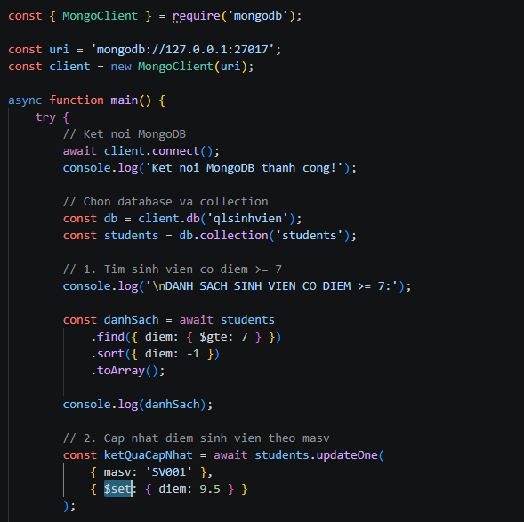
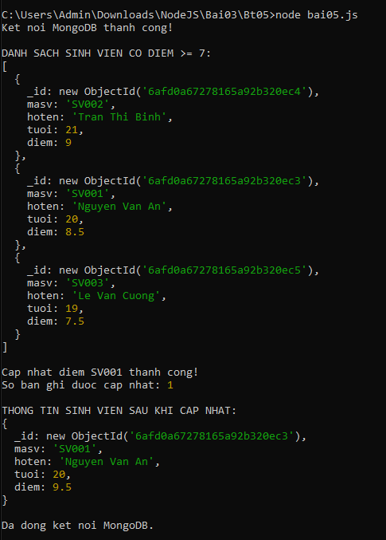

## 1. Các lệnh thực hiện

**Khởi tạo project:**

```cmd
npm init -y
```

**Cài đặt thư viện MongoDB:**

```cmd
npm install mongodb
```

**Chạy chương trình:**

```cmd
node bai05.js
```

## 2. Hình ảnh các bước thực hiện

### Mã nguồn bai05.js



## 3. Kết quả cuối cùng


